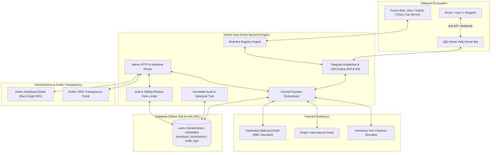

# 🇰🇭 KHMER HELP KHMER (ខ្មែរជួយខ្មែរ)
### Production-Ready Telegram Donation Platform & Multi-Bot Architecture

> *"Together, we can help one Khmer family at a time."*  
> *«រួមគ្នា យើងអាចជួយគ្រួសារខ្មែរមួយម្តងៗ»*

---

## 📌 Executive Overview

**Khmer Help Khmer** is a humanitarian crowdfunding and direct assistance platform built for Cambodia. It connects donors worldwide with verified individuals in urgent need of medical treatment, educational funding, and elderly survival support, as well as operational funding for field rescue missions.

The platform is built on modern, dependency-light Node.js architecture with native SQLite (WAL mode), strict idempotency guards, Cambodian Bakong KHQR (NBC EMVCo standard), test payment simulation, dual-language support (ភាសាខ្មែរ 🇰🇭 & English 🇬🇧), a secure responsive Admin Dashboard, and a modular **Multi-Bot Engine** designed to power future Telegram bots on the exact same backend.

---

## 🏗️ Technical Architecture

The architecture separates bot interaction, payment orchestration, and administrative verification into modular layers:



---

## 📁 Project Directory Structure

```text
d:\bot father\
├── src/
│   ├── index.js                     # Master entrypoint & bootstrap
│   ├── config.js                    # Typed environment configuration loader
│   ├── core/
│   │   ├── db/
│   │   │   ├── database.js          # Node native DatabaseSync (WAL mode, transactions)
│   │   │   ├── schema.sql           # Complete SQL schema & indexes
│   │   │   └── seed.js              # Realistic Cambodian cases (Khmer & English)
│   │   ├── security/
│   │   │   ├── auth.js              # PBKDF2 hashing & HMAC session tokens
│   │   │   ├── rate_limiter.js      # Sliding-window memory rate limiter
│   │   │   └── validator.js         # Input sanitization & bounds checks
│   │   ├── audit/
│   │   │   └── audit_logger.js      # Tamper-evident immutable audit log
│   │   ├── payments/
│   │   │   ├── payment_service.js   # Central orchestrator & idempotency guard
│   │   │   ├── receipt_generator.js # Bilingual digital donation receipts
│   │   │   └── providers/
│   │   │       ├── base_provider.js # Provider abstract class
│   │   │       ├── test_provider.js # Simulated gateway for testing
│   │   │       ├── bakong_khqr.js   # NBC EMVCo KHQR generator & checker
│   │   │       └── stripe_gateway.js# Card gateway interface
│   │   ├── notifications/
│   │   │   └── notifier.js          # Telegram dispatchers for receipts & alerts
│   │   └── multi_bot/
│   │       └── bot_registry.js      # Registry for running multiple bots on 1 backend
│   ├── bot/
│   │   ├── telegram_client.js       # Native fetch Telegram Bot API client
│   │   ├── bot_dispatcher.js        # Main message & callback router
│   │   ├── bot_service.js           # Polling and webhook lifecycle runner
│   │   ├── keyboards.js             # Dynamic Telegram inline keyboards
│   │   ├── helpers.js               # Progress bars & currency helpers
│   │   ├── i18n/                    # Bilingual translation engine
│   │   │   ├── km.js                # Khmer dictionary
│   │   │   ├── en.js                # English dictionary
│   │   │   └── index.js             # Language getter & setter
│   │   └── handlers/
│   │       ├── start_handler.js
│   │       ├── category_handler.js
│   │       ├── beneficiary_handler.js
│   │       ├── donation_handler.js
│   │       ├── team_fund_handler.js
│   │       ├── my_donations_handler.js
│   │       ├── transparency_handler.js
│   │       └── language_handler.js
│   └── server/
│       ├── http_server.js           # Native HTTP server & static file host
│       ├── router.js                # Lightweight REST router with CORS
│       ├── controllers/
│       │   ├── auth_controller.js
│       │   ├── admin_controller.js
│       │   ├── payment_controller.js
│       │   ├── webhook_controller.js
│       │   └── public_controller.js
│       └── static/
│           ├── admin/index.html     # Modern Admin SPA (Dark blue, gold, responsive)
│           ├── checkout/index.html  # Interactive Payment & Test Mode Checkout
│           └── public/transparency.html # 100% Public Transparency Portal
├── test/
│   ├── unit.test.js                 # Validation, math, crypto, and i18n tests
│   ├── payment.test.js              # Idempotency, target reached, balance tests
│   ├── verification.test.js         # State machine & approval workflow tests
│   ├── bot_flow.test.js             # Complete bot dialog & callback simulation
│   └── e2e_live_test.js             # End-to-end integration test
├── .env.example                     # Environment template with documentation
├── package.json
├── run.bat                          # Quick start Windows batch file
└── README.md
```

---

## 🚀 Quick Start Guide

### 1. Prerequisites
- **Node.js**: Version 20.0.0 or newer (Node 24 with native SQLite and test runner included).
- No external npm package installations required! Zero brittle dependency drift.

### 2. Configure Environment
Copy `.env.example` to `.env`:
```powershell
Copy-Item .env.example .env
```

Open `.env` and review key variables:
```ini
NODE_ENV=development
PORT=3000
APP_URL=http://localhost:3000

# Telegram Bot Token (from @BotFather)
TELEGRAM_BOT_TOKEN=your_token_here
TELEGRAM_USE_WEBHOOK=false

# Admin Credentials
ADMIN_USERNAME=admin
ADMIN_PASSWORD=KhmerHelpKhmer2026!

# Payment Mode ('test' for simulator, 'production' for live)
PAYMENT_MODE=test
PAYMENT_PROVIDER=test
```

### 3. Run the Automated Test Suite
Run the 23 unit, payment, and bot flow tests:
```powershell
node --test test/unit.test.js test/payment.test.js test/verification.test.js test/bot_flow.test.js
```
*Expected: 23 passed, 0 failed.*

Run the end-to-end integration test:
```powershell
node test/e2e_live_test.js
```

### 4. Start the Application
Run via npm or node:
```powershell
node src/index.js
```
*Or double-click `run.bat` on Windows.*

Console output will display:
```text
============================================================
🇰🇭 KHMER HELP KHMER - PRODUCTION CHARITY PLATFORM
============================================================
[Init] Connecting to database: ./data/khmer_help_khmer.db
[Init] Database schema migrations executed successfully.
[Auth] Default admin created: admin
[Seed] Database populated successfully with realistic Cambodian cases!
[HTTP Server] Listening on http://localhost:3000
[Admin Portal] Access admin dashboard: http://localhost:3000/admin
[Transparency] Public audit portal: http://localhost:3000/public/transparency.html
[Payment Mode] Current mode: TEST (Provider: test)
```

---

## 🤖 Connecting to Telegram with @BotFather

1. Open Telegram and search for [@BotFather](https://t.me/BotFather).
2. Send `/newbot` and follow the instructions:
   - **Name**: `Khmer Help Khmer`
   - **Username**: e.g., `KhmerHelpKhmerBot`
3. Copy the HTTP API token provided by BotFather (looks like `123456789:ABCdefGhIJKlmNoPQRsTUVwxyZ`).
4. Paste the token into your `.env`:
   ```ini
   TELEGRAM_BOT_TOKEN=123456789:ABCdefGhIJKlmNoPQRsTUVwxyZ
   ```
5. Configure your bot settings in @BotFather:
   - `/setdescription`:
     ```text
     🇰🇭 KHMER HELP KHMER
     Together, we can help one Khmer family at a time.
     Browse verified Cambodian sick, students, and elderly cases and donate starting from $0.10.
     ```
   - `/setabouttext`:
     ```text
     Transparent Cambodian donation platform connecting donors with verified people in urgent need.
     ```
   - `/setcommands`:
     ```text
     start - Launch Khmer Help Khmer main menu
     help - Learn how donations work & about our team
     transparency - View public donations & distributions
     contact - Contact administrator support
     ```
6. Restart the backend (`node src/index.js`). The bot will log:
   ```text
   [BotService] Connected to Telegram as @KhmerHelpKhmerBot (Khmer Help Khmer)
   [BotService] Starting long polling for development...
   ```
7. Open your bot in Telegram and click **START**!

---

## 🧪 Testing a $0.10 Donation in TEST MODE (Step-by-Step)

The system includes a dedicated **Interactive Test Checkout Simulator** so you can test complete end-to-end donations without risking real money:

1. **Launch the Bot**:
   - Send `/start` to the bot.
   - Choose language if prompted (ភាសាខ្មែរ 🇰🇭 or English 🇬🇧).
2. **Select a Category**:
   - Click `❤️ Help Sick People` (or Students / Elderly / Team).
   - The bot displays verified Cambodian cards with photos, needed, received, remaining, and progress percentage.
3. **View Details**:
   - Click `[📖 VIEW DETAILS]` under **Lok Yeay Sokha**.
   - Notice the full story, verification badge, and visual ASCII progress bar.
4. **Initiate Donation**:
   - Click `[❤️ DONATE NOW]`.
   - Select the `$0.10` preset button (or click `[✏️ Custom Amount]` and type `0.10`).
5. **Confirmation & Checkout Link**:
   - The bot responds with the confirmation card showing Beneficiary, Amount ($0.10), Donation Code, and Transaction ID.
   - Click the inline button: `[💳 PAY NOW]`.
6. **Interactive Payment Simulator**:
   - The payment link opens in your browser: `http://localhost:3000/checkout/TX-...`.
   - You will see the beneficiary card, yellow `🧪 TEST MODE SIMULATOR` badge, and donation amount.
   - Click **`✅ Approve & Pay $0.10`**.
7. **Instant Verification & Receipt**:
   - The checkout page turns green and confirms payment.
   - The backend atomically increments the beneficiary's `amount_received` by $0.10.
   - The bot instantly delivers a bilingual digital receipt into your Telegram chat with Transaction ID, Date, and `✅ PAID` status.
8. **Check My Donations in Telegram**:
   - Click `[📊 My Donations]` in the bot menu.
   - Your total donated balance and donation count immediately reflect the new $0.10 contribution!

---

## 🛡️ Admin Dashboard Walkthrough

Access the Admin Dashboard at: **`http://localhost:3000/admin`**

### Default Admin Credentials:
- **Username**: `admin`
- **Password**: `KhmerHelpKhmer2026!` *(Change via `.env` in production)*

### Admin Dashboard Sections:

| Section | Capabilities |
| :--- | :--- |
| **📊 Dashboard** | Real-time stats cards (Total Donated, Total Distributed, Active/Completed Campaigns, Donors, Pending Verifications) and recent transactions table. |
| **👥 Beneficiaries** | Browse all campaigns, view received vs target funds, and click **`+ Add New Beneficiary`** to register new Cambodian cases with photos and stories. |
| **✅ Verification Queue** | Review pending beneficiary submissions. Workflow buttons: **`Approve (VERIFIED)`**, **`Reject`**, or **`Request Info`**. Only verified beneficiaries can receive public donations. |
| **💰 Donations Audit** | Live transaction ledger. Search by Donation ID, Telegram ID, or Transaction ID. Filter by status (`PAID`, `PENDING`, `FAILED`). |
| **👤 Donors** | View all registered Telegram users, language preferences, total donated volume, and donation count. |
| **📦 Distribution Management** | Separate assistance record keeping. Click **`+ Record New Distribution`** to log cash handovers, bank transfers, or medical supply purchases with reference numbers and proof URLs. |
| **📢 Telegram Broadcast** | Dispatch verified announcements to all bot donors with optional photos, confirmation guard, and delivery statistics (`Sent`, `Failed`). |
| **⚙️ Immutable Audit Logs** | Tamper-evident ledger recording every single login, donation, status change, and distribution with actor ID and IP address. |

---

## 💳 Payment Gateway Configurations

### 1. Cambodian Bakong KHQR (NBC Standard)
The platform natively constructs EMVCo-compliant dynamic QR payloads adhering to the National Bank of Cambodia standard:
- Tag 29: Merchant Account Information (ABA Bank / Bakong Account)
- Tag 53: Currency (840 for USD, 116 for KHR)
- Tag 54: Dynamic Transaction Amount
- Tag 62: Bill / Reference Number (`transaction_id`)
- Tag 63: CRC16/CCITT checksum verification

In `.env`, configure:
```ini
PAYMENT_MODE=production
PAYMENT_PROVIDER=bakong_khqr
BAKONG_MERCHANT_ID=khmer_help_khmer@aba
BAKONG_ACQUIRING_BANK=ABA Bank
BAKONG_MERCHANT_NAME=Khmer Help Khmer Charity
BAKONG_MERCHANT_CITY=Phnom Penh
PAYMENT_WEBHOOK_SECRET=your_production_secret
```

### 2. Stripe / International Cards
For international card donors:
```ini
PAYMENT_PROVIDER=stripe
STRIPE_SECRET_KEY=sk_live_...
STRIPE_WEBHOOK_SECRET=whsec_...
```

### 3. Duplicate Payment & Replay Protection
- Every donation session generates a unique `idempotency_key` and `transaction_id`.
- The database enforces `UNIQUE(transaction_id)` and `UNIQUE(idempotency_key)`.
- `payment_service.js` uses atomic transactions: if a webhook arrives a second time for an already `PAID` donation, it returns immediately without incrementing the beneficiary or campaign balance.

---

## 🌐 Multi-Bot Architecture Extension

The platform is designed so that future Telegram bots can seamlessly plug into the existing backend:

```text
Future Bots:
├── 💼 Job Marketplace Bot
├── 🎟️ Concert Tickets Bot
├── 📢 Media Agency Bot
├── 🛍️ Telegram Shop Bot
└── 🚗 Car Service Bot
```

### How to Add a New Bot:
1. Create a bot handler in `src/bots/<bot_name>/`.
2. Register the bot with `src/core/multi_bot/bot_registry.js`:
   ```javascript
   const botRegistry = require('../../core/multi_bot/bot_registry');

   class JobMarketplaceBot {
     constructor() {
       this.name = 'Cambodia Job Marketplace';
     }
     async dispatchUpdate(update) {
       // Handle bot messages & commands
     }
   }

   botRegistry.register('job_marketplace', new JobMarketplaceBot());
   ```
3. Set up the webhook in Telegram pointing to:
   ```text
   https://yourdomain.com/webhook/telegram/job_marketplace
   ```
4. The new bot instantly reuses the existing user database, payment gateways, audit logging, rate limiting, and admin management!

---

## 🚀 Production Deployment (VPS / Ubuntu / Debian)

### 1. Clone & Set Up on Server
```bash
git clone <your-repo-url> /var/www/khmer-help-khmer
cd /var/www/khmer-help-khmer
cp .env.example .env
nano .env # Set your domain, bot token, and payment credentials
```

### 2. Run with PM2 Process Manager
```bash
npm install -g pm2
pm2 start src/index.js --name "khmer-help-khmer"
pm2 save
pm2 startup
```

### 3. Configure Nginx Reverse Proxy with SSL
```nginx
server {
    server_name donate.khmerhelpkhmer.org;

    location / {
        proxy_pass http://127.0.0.1:3000;
        proxy_http_version 1.1;
        proxy_set_header Upgrade $http_upgrade;
        proxy_set_header Connection 'upgrade';
        proxy_set_header Host $host;
        proxy_set_header X-Real-IP $remote_addr;
        proxy_set_header X-Forwarded-For $proxy_add_x_forwarded_for;
        proxy_cache_bypass $http_upgrade;
    }
}
```
Obtain free SSL certificates via Certbot:
```bash
certbot --nginx -d donate.khmerhelpkhmer.org
```

### 4. Enable Telegram Webhook in Production
Set in `.env`:
```ini
APP_URL=https://donate.khmerhelpkhmer.org
TELEGRAM_USE_WEBHOOK=true
TELEGRAM_WEBHOOK_SECRET=your_32_character_secret_token
```
Restart the service (`pm2 restart khmer-help-khmer`). The bot service will automatically call Telegram's `setWebhook` API with your secret token.

---

## 🔒 Security Best Practices Implemented

- **No Hardcoded Secrets**: All tokens, keys, and credentials reside strictly in `.env`.
- **Card Security**: Raw card details are never accepted or stored.
- **Privacy Protection**: Beneficiary private contact numbers and medical hospital record sheets are accessible only to verified administrators, never exposed to Telegram users.
- **Idempotency Protection**: Unique transaction constraints prevent double-crediting.
- **Rate Limiting**: Sliding-window token bucket prevents spam attacks on both Telegram updates and HTTP endpoints.
- **Tamper-Evident Audit Logs**: All money-related events write immutable entries into `audit_logs`.
- **Dual-Language i18n**: Native Khmer and English dictionaries for seamless donor experience.

---

## 📄 License & Humanitarian Attribution

Khmer Help Khmer is licensed under the MIT License. Dedicated to the resilient people of Cambodia.
```text
🇰🇭 "ខ្មែរជួយខ្មែរ ខ្មែរស្រឡាញ់ខ្មែរ" - Together, we can help one Khmer family at a time.
```
